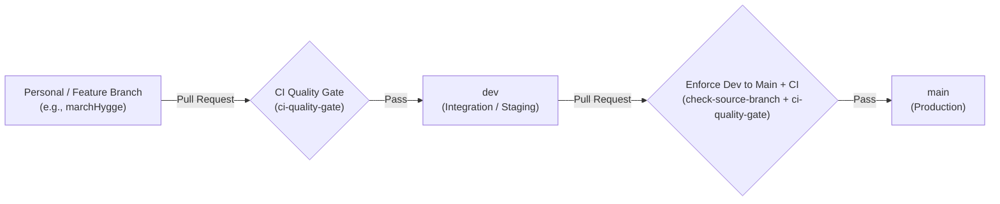

# Kafka Banking Digital Twin

Real-time banking digital twin streaming and event processing platform powered by Apache Kafka.

---

## Git Workflow & Branching Strategy

This repository enforces a strict **3-tier branching model** combined with automated **GitHub Actions Quality Gates** and **Branch Protection Rules** to keep `dev` and `main` clean, stable, and deployable at all times.



### 1. Branch Roles & Protection Rules

| Branch | Role | Direct Push | Pull Request Required | Required Status Checks | Admin Enforcement |
| :--- | :--- | :---: | :---: | :--- | :---: |
| **`main`** | Production-ready source of truth | ❌ Blocked | ✅ Yes | `check-source-branch`, `ci-quality-gate` | ✅ Enforced (`enforce_admins: true`) |
| **`dev`** | Integration & staging environment | ❌ Blocked | ✅ Yes | `ci-quality-gate` | ✅ Enforced (`enforce_admins: true`) |
| **`<personal>`** *(e.g. `marchHygge`)* | Individual development & feature work | ✅ Allowed | ❌ No | None (checked upon opening PR to `dev`) | N/A |

---

## Automated CI/CD Quality Gates (`.github/workflows/`)

### 1. `ci-quality-gateway.yml` (Job: `ci-quality-gate`)
Triggered automatically on every Pull Request targeting **`dev`** or **`main`**. It blocks broken code before it can be merged:
- **Merge Conflict Marker Detection:** Fails if unresolved Git conflict markers (`<<<<<<<`, `=======`, `>>>>>>>`) are present in any tracked file.
- **Docker Compose Validation:** Runs `docker compose config -q` when `docker-compose.yml` / `docker-compose.yaml` is present.
- **Python Syntax Compilation:** Runs `python3 -m py_compile` across all `.py` files when Python source files are present.

### 2. `restrict-main.yml` (Job: `check-source-branch`)
Triggered automatically on every Pull Request targeting **`main`**:
- Verifies that `github.head_ref == "dev"`.
- **Blocks any Pull Request into `main` that does not originate from the `dev` branch.**

---

## Step-by-Step Developer Guide

### 1. Starting New Work (Sync from `main`)
Always start new features from an up-to-date personal branch synced with `main`:

```bash
git checkout marchHygge
git pull origin main
```

### 2. Committing & Pushing to Your Personal Branch
Develop and test locally, then push changes to your personal branch:

```bash
git add .
git commit -m "feat: describe your change clearly"
git push origin marchHygge
```

### 3. Merging into `dev` (Integration & Testing)
1. Open a Pull Request on GitHub: **base: `dev`** $\leftarrow$ **compare: `marchHygge`**.
2. Wait for **`CI Quality Gate / ci-quality-gate`** to pass ✅.
3. If the check fails ❌, fix the errors locally on `marchHygge` and push again—the PR will automatically re-run the check.
4. Once all checks pass, click **Merge pull request**.

> **Handling Merge Conflicts with `dev`:**
> Only pull from `dev` into your personal branch when you need a teammate's integrated changes or need to resolve a merge conflict with `dev`:
> ```bash
> git checkout marchHygge
> git pull origin dev
> # Resolve any conflicts, then commit and push:
> git add .
> git commit -m "chore: resolve merge conflicts with dev"
> git push origin marchHygge
> ```

### 4. Releasing to `main` (Production)
Once changes on `dev` are verified and ready for release:
1. Open a Pull Request on GitHub: **base: `main`** $\leftarrow$ **compare: `dev`**.
2. Wait for both required checks (**`check-source-branch`** and **`ci-quality-gate`**) to pass ✅.
3. Click **Merge pull request**.
