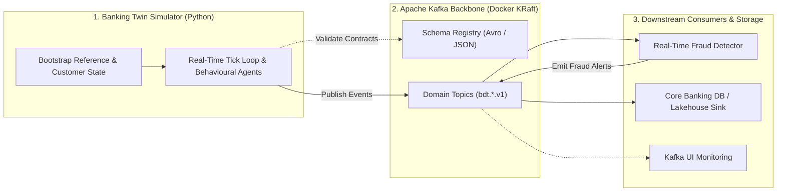
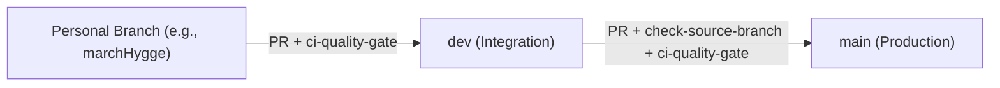

# Kafka Banking Digital Twin

Real-time banking digital twin streaming and event processing platform powered by **Apache Kafka**.

---

## 1. High-Level Architecture & Data Flow

The platform simulates a live retail banking ecosystem (customers, behavioural decisions, accounts, payments, lending, digital channels, and fraud patterns) and streams domain events in real time through Apache Kafka to downstream processing consumers.



---

## 2. Repository Structure & Roadmap

```text
kafka-banking-digital-twin/
├── .github/workflows/       # ✅ Automated CI Quality Gate & Branch Protection
├── docs/                    # ✅ Detailed engineering & workflow documentation
│   └── git-workflow.md      #    Step-by-step Git branching & CI/CD guide
├── docker-compose.yml       # 🚧 [Planned] Kafka (KRaft), Schema Registry, Kafka UI, PostgreSQL
├── schemas/                 # 🚧 [Planned] Avro (.avsc) & JSON event contracts
├── ddl/postgresql/          # 🚧 [Planned] Core banking relational schemas
├── simulator/               # 🚧 [Planned] Real-time banking event generator & Kafka producer
└── consumers/               # 🚧 [Planned] Real-time fraud detection & persistence consumers
```

---

## 3. Getting Started

> *🚧 Upcoming: Instructions for starting the local Kafka KRaft cluster (`docker compose up -d`), registering schemas, and running the real-time simulator will be added as each module is implemented.*

---

## 4. Git Workflow & CI/CD Overview

All contributions follow a strict **3-tier promotion flow** enforced by GitHub Actions:



- **Flow:** `<personal-branch>` $\rightarrow$ **`dev`** $\rightarrow$ **`main`** (Direct pushes to `dev`/`main` and PRs to `main` from non-`dev` branches are blocked).
- **Automated Checks:** Every PR automatically validates merge conflicts, `docker compose config -q`, and `python3 -m py_compile`.
- 📖 **Full Guide:** See **[docs/git-workflow.md](./docs/git-workflow.md)** for branch protection details, commands, and conflict resolution steps.

---

## 5. Documentation (`docs/`)

- **[Git Workflow & CI/CD Quality Gates](./docs/git-workflow.md)** — Detailed branching rules, automated checks, and developer step-by-step commands.
- *More technical documentation (Kafka Topic Contracts, Simulator Configuration, Consumer Architecture) will be added to [`docs/`](./docs/) as development progresses.*
